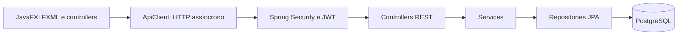

# Arquitetura

Os projetos são independentes: API e desktop têm seu próprio Maven e Git.
O desktop nunca acessa o banco diretamente. A API verifica o token e identifica
o usuário antes das operações.

TaskService trabalha em transações. Consultas por ID de tarefa incluem também
o ID do usuário. Uma tarefa de outra conta é tratada como não encontrada,
sem revelar sua existência. As rotas legadas com userId conferem explicitamente
a identidade autenticada.

O JWT tem validade de duas horas medida com Instant, independentemente do fuso
da máquina. O desktop guarda o token em memória e volta ao login ao receber 401.
Não existe renovação automática.

DTOs evitam retornar entidades com senha ou relações JPA. O frontend recebe
datas de criação locais, sem offset: elas são informativas e não representam
um contrato global de fusos. Busca e filtros são locais à lista carregada.

H2 permite testes rápidos e independentes. A pipeline complementa a cobertura
com PostgreSQL, pois o comportamento do banco em memória não é idêntico ao banco real.
